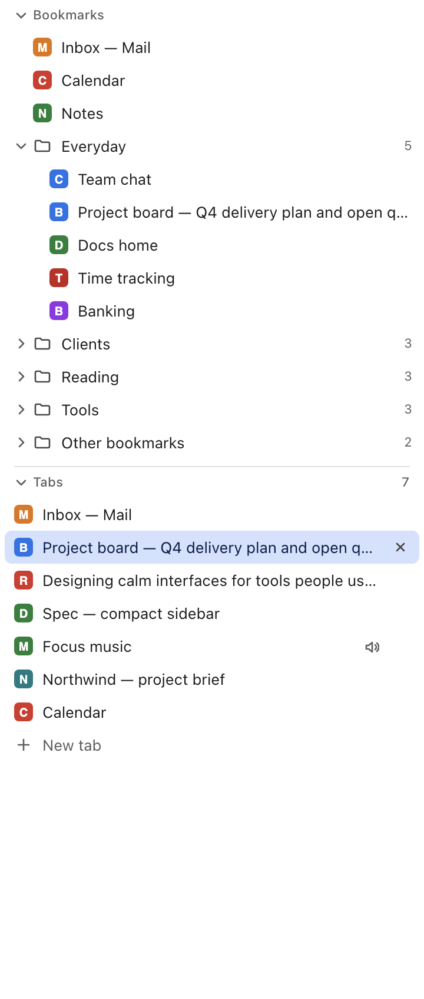
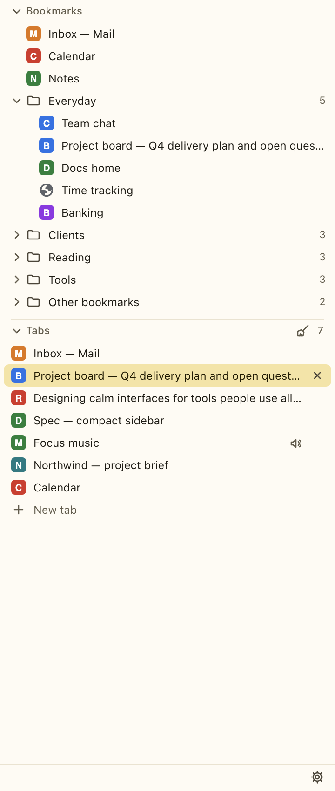

# Compact Sidebar

**Your bookmarks above this window's tabs, in one Chrome side panel.**

On a laptop, Chrome's vertical tabs plus its bookmarks panel take about 600 px of the screen. Compact Sidebar puts both into a single side panel at Chrome's minimum width, with drag-and-drop bookmark editing, emoji and colour icons, and a one-click Tidy for tabs. It runs entirely on your machine: no account, no analytics, and out of the box no network requests at all.

<p>
  
  &nbsp;
  
</p>

*Screenshots use invented bookmarks and pages.*

## Features

**Bookmarks**
- Chrome's own bookmarks, nothing separate to sync: the bookmarks bar inline, folders that expand, "Other bookmarks" as a folder.
- Click to open in this window; ⌘/Ctrl-click or middle-click opens in the background.
- **Edit in place:** drag to move bookmarks and folders; drag a tab in to save it; right-click for **Edit** (title and URL), **Delete**, **New folder** and **Add current tab**.
- **Undo** the last change from the footer, or with ⌘/Ctrl+Z.
- **Icons:** give any bookmark or folder an emoji (a grid of common ones, or any emoji from your system's emoji picker), or give a folder a colour (Chrome's tab-group colours).

**Tabs**
- The tabs of the window the panel sits in, in tab-strip order: click to switch, × or middle-click to close, plus a New tab row. Each window has its own panel.
- **Tidy:** the broom on the Tabs heading closes every tab except the selected one and pinned tabs. Undo reopens them where they were (without their back history; Chrome's own *Reopen closed tab* still has that).

**Everything else**
- Both sections fold, and the panel remembers which folders are open.
- Live updates from Chrome's events; nothing polls.
- Two colour treatments, **Neutral** (like Chrome, the default) and **Warm**, each following your system's light or dark mode.
- **Optional nightly sweep** (off by default): once a day at 03:00, or the first time Chrome runs after that, it closes tabs you haven't used in the last 3 hours. It keeps the selected tab of the focused window and tabs playing audio, never closes a window, and never touches bookmarks.

Deliberately not included: tabs of other windows, search, tab archives, a New Tab page replacement, or anything that phones home.

## Install

There's no Chrome Web Store listing; you load it yourself. Chrome 150 or newer.

1. Download the latest `compact-sidebar-<version>.zip` from [Releases](../../releases) and unzip it somewhere permanent. Chrome runs the extension from that folder.
2. Open `chrome://extensions`, turn on **Developer mode**, click **Load unpacked**, and choose the unzipped folder.
3. Pin the icon in the toolbar. Click it, or press **Ctrl+Shift+S** (**⇧⌘S** on a Mac), to open or close the panel. You can change the shortcut at `chrome://extensions/shortcuts`.

**Recommended layout:** in Chrome's settings, put the **side panel on the left**, and if you use vertical tabs, collapse them to the narrow icon rail. An extension can't hide Chrome's own tab strip, so your tabs appear both there and in the panel.

**Updating:** Chrome knows an unpacked extension by its folder. Replace the folder's contents with the new version's files and click the reload icon on the extension's card at `chrome://extensions`; your settings and icons stay. (Removing the extension and loading a new folder also works, but starts with fresh settings.)

## Using it

| | Mouse | Keyboard |
|---|---|---|
| Move around | | ↑/↓, Home/End (the whole list is one tab stop) |
| Open a folder / step in, close / step out | click the folder | → / ← (on a section heading: fold it) |
| Open a bookmark, switch to a tab | click | Enter or Space (⌘/Ctrl+Enter: in the background) |
| Close a tab | × or middle-click | Delete or Backspace |
| Edit a bookmark or folder (title, URL, icon) | right-click → Edit… | F2 |
| Delete a bookmark or folder | right-click → Delete | Delete or Backspace |
| Move a bookmark or folder | drag | ⌥/Alt+↑ / ↓ within its folder |
| Save a tab as a bookmark | drag the tab into Bookmarks, or right-click → Add current tab | Shift+F10 → Add current tab |
| Tidy (close all but the selected and pinned tabs) | the broom on the Tabs heading | Tab to the broom, then Space |
| Undo the last change | Undo in the footer | ⌘/Ctrl+Z |

In the editor, Enter saves and Escape cancels. Click the icon left of the name to choose an emoji or folder colour.

## Options

Open them with the ⚙ at the bottom of the panel:

- **Colours:** Neutral or Warm.
- **Site icons (off by default):** Chrome only has icons for pages you've visited, so a bookmark you've never opened shows a globe. Switch this on and the panel asks those bookmarks' own sites for their icon instead. What that means for privacy is described in [SECURITY.md](SECURITY.md).
- **Nightly sweep (off by default):** the tab sweep described above.

## Privacy and permissions

Everything stays on your machine. There are no host permissions, no content scripts and no analytics, and out of the box the extension makes no network requests at all. The only requests it can make are the optional site icons. The full picture is in [SECURITY.md](SECURITY.md).

| Permission | Why |
|---|---|
| `sidePanel` | The panel itself. |
| `bookmarks` | Read your bookmarks, and change them when you edit them in the panel. Chrome warns "Read and change your bookmarks". |
| `tabs` | Titles and URLs of the panel's window. Chrome warns "Read your browsing history". |
| `favicon` | Site icons from Chrome's local favicon cache. |
| `storage` | Settings, open folders, your bookmark icons, and the sweep's counts-only receipts, on your machine. |
| `alarms`, `webNavigation` | The nightly sweep: a periodic "is it due?" check, and counting navigations as use. |

## Known limits

- Chrome's side panel is at least 378 px wide and has its own 49 px header; no extension can change either.
- Another extension's side panel replaces this one in that window until you click the icon again, and Chrome doesn't reopen side panels after a restart.
- Pinned tabs show as ordinary rows; tab groups aren't shown.
- Bookmark icons are stored by the extension, not in Chrome's bookmarks, so they don't sync to your other devices.
- Nightly sweep: a page that asks "Leave site?" stays open with its prompt; pages that don't ask lose unsaved input. A tab read for hours without switching to it counts as unused.

## Development

```bash
pnpm install
pnpm check     # typecheck + tests + build → dist/extension, with its sha256
```

- `extension/src/sidebar.ts`: rows, keyboard, bookmark edits, Undo and Tidy, behind the `SidebarBrowser` seam. `sidebar-chrome.ts` is the Chrome adapter; the tests use an in-memory fake.
- `extension/src/sweep.ts`: the nightly sweep, behind the `Browser` seam (`chrome-browser.ts`).
- `panel.ts`, `options.ts`, `background.ts`: rendering and wiring.
- `GLOSSARY.md`: the project's vocabulary (Sidebar, Bookmark edit, Tidy, …).
- `scripts/sidebar-feasibility.mjs` and `scripts/feasibility.mjs` drive [Chrome for Testing](https://googlechromelabs.github.io/chrome-for-testing/) with throwaway profiles and synthetic pages: `CFT_BIN=<binary> pnpm sidebar:measure`. On macOS, `HARNESS_BACKGROUND=1` keeps the test browser behind your work (the shortcut trigger is then skipped, since Chrome sends shortcuts only to a focused window). Never point them at your own Chrome profile.
- Releases: push a tag `v<version>` matching `manifest.json`; GitHub Actions builds the zip and publishes it.

## Contributing and support

Issues and pull requests are welcome. This is a small tool, kept deliberately small, and maintained on a best-effort basis, so not every feature request will make it in. Please report security issues privately, as described in [SECURITY.md](SECURITY.md).

## About

Compact Sidebar is built and maintained by **[MF Consulting](https://matthiasfrank.de/en/notion-consulting/)**. We help teams work better with Notion and AI, and build custom software when off-the-shelf tools don't fit. If that sounds like something your team needs, [get in touch](https://matthiasfrank.de/en/notion-consulting/).

## License

[MIT](LICENSE) © MF Consulting
